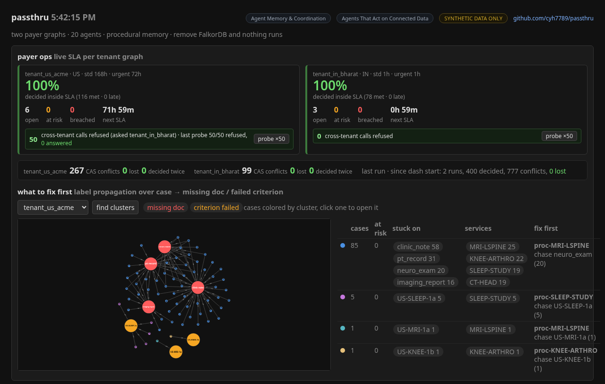
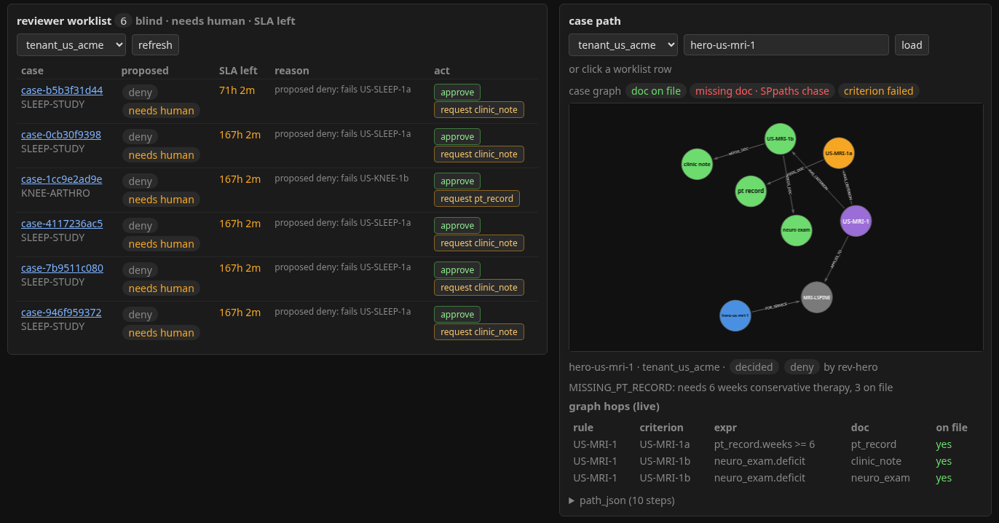
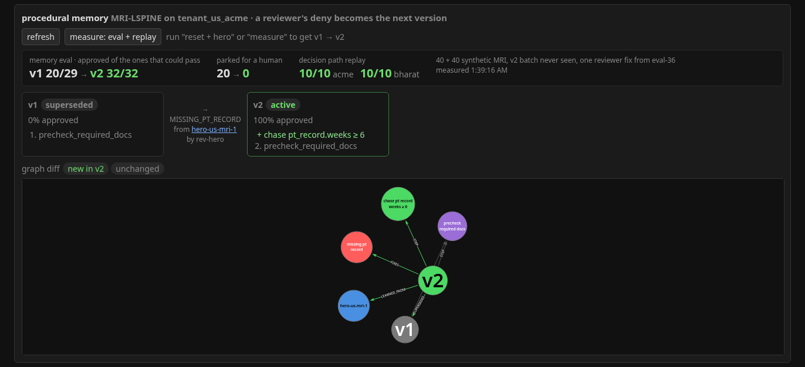

# passthru

Multi-tenant prior authorization agents on FalkorDB. Built for Graph Hacks 2026 (WeMakeDevs x FalkorDB).

Tracks: **Agent Memory & Coordination** (primary) and **Agents That Act on Connected Data**.

The idea: each payer gets its own graph of rules, required docs and learned procedures. Agents walk that graph to figure out what's missing before a request gets denied. I'm borrowing a few things that already work elsewhere (Taiwan NHI style machine-readable rules + an AI completeness precheck, an auto-approve list) and pointing them at US PA and India cashless pre-auth.

All data here is synthetic. Nothing is a real policy or a real patient. Numbers below are from seeded runs on my box, not clinical or regulatory results. Remove FalkorDB and nothing here runs — multigraph isolation, CAS claims, shortest-path chase, and label-propagation clusters all sit on it.

Write-up of the why: [BLOG.md](BLOG.md).

## run it

```
make setup
make up        # falkordb on :6379, browser on http://localhost:3000
make data      # regenerates data/*.json (seed 42, already committed)
make load
make demo      # one-shot: reset + 20-worker swarm + hero v1→v2 + clusters + replay + isolation (SEED=42)
make run       # single worker, decides every queued case
make swarm     # 20 workers at once (12 on acme, 8 on bharat), prints conflicts / duplicates
make hero      # hero case: same MRI to both payers, then procedure v2 (run after make load)
make mcp T=tenant_us_acme   # MCP server over stdio, bound to one tenant
make dash      # dashboard on http://localhost:8000, see "the dashboard" below
make evalmem   # v1 on 40 MRI cases -> one reviewer fix -> v2 on 40 unseen ones (resets graphs)
make replay    # re-walk 10 decided paths per tenant
make test
```

If a newer dep breaks something, `.venv/bin/pip install -r requirements.lock` gets the exact versions I tested with (fresh clone → `make setup` → `make demo` checked 10/16).

`make demo` is the judge path. Leave `make dash` running in another terminal if you want the live board while it prints.

## the dashboard

`make dash`, then http://localhost:8000. Plain HTML + Starlette, the graphs are drawn with [@falkordb/canvas](https://www.npmjs.com/package/@falkordb/canvas) (MIT) off jsDelivr, no build step. Everything updates over SSE from the graphs.



Payer ops on top: one tile per tenant graph with SLA met %, open / at risk / breached and the next deadline ticking. "probe ×50" makes an agent bound to one tenant ask the other one 50 times; the badge counts the refusals (`AccessDenied` nodes in its own graph). The strip under it is CAS conflicts / lost / decided twice per tenant while a swarm runs. "What to fix first" is the label propagation map: red hubs are missing docs, amber are failed criteria, dots are stuck cases colored by cluster. Click a dot to open that case.



Reviewer worklist: the blind queue (no names, no facility), SLA left, approve or request a doc. There's no deny button here on purpose. Clicking a row opens the case graph on the right: the rule → criterion → doc hops it walked, green if the doc is on file, red for missing docs plus the `algo.SPpaths` chase, amber for the criterion that failed.



Procedural memory: MRI-LSPINE v1 → v2 after one blind reviewer deny on the hero case, and the same thing as a small graph diff (new in v2 in green: the chase step, `FIXES`, `LEARNED_FROM`). "measure: eval + replay" runs `evalmem` and `replay` and puts the numbers on the card.

For a demo, in the same order as my video: "reset + swarm" and watch the tiles / ticker → "measure: eval + replay" (re-runs the swarm plus hero v1 → v2, then the eval + replay numbers land on the card) → open `hero-us-mri-1`, then `hero-in-mri-1` (`#case=tenant_in_bharat/hero-in-mri-1`) → procedure card + `hero-us-mri-2` → "find clusters" → "probe ×50". "reset + hero" alone is the quick way to get just v1 → v2.

## hero case

`make hero` sends one synthetic lumbar MRI package (clinic note, neuro exam, 3 weeks of PT, estimate, ID) to both payers. Same request, two graphs, two doc lists:

- Acme wants `clinic_note`, `neuro_exam`, `pt_record`. 3 weeks fails `pt_record.weeks >= 6`, the agent proposes a deny, a blind reviewer signs it off as `MISSING_PT_RECORD`.
- Bharat wants `clinic_note`, `estimate`, `id_proof`. All there, approved by the agent.

Then part 2:

- The reviewer's fix (`chase_doc pt_record.weeks >= 6`) goes through `procedure.learn_from_review` and becomes `proc-MRI-LSPINE` v2. It only works off a blind reviewer's deny, and the swap is a version CAS (v1 has to still be active at version 1, or 0 rows and you lost).
- Next Acme MRI ships the same stale package (3 weeks PT), but the clinic chart now has 7. v2 runs the chase step first, pulls the current PT record from the provider graph, swaps it onto the case (keeps the original as `prev_data`), and the rules approve it.
- If the chart is still short, it pends with "chase: pt_record.weeks 4 < 6" instead of going out to get denied.
- Success rate per version: v1 0/1, v2 1/1.

## graphs

One FalkorDB instance, three graphs:

- `tenant_us_acme`, `tenant_in_bharat`: payer graphs, same schema, separate data
- `provider_demo`: patients, coverage, documents

Payer graph:

```
(:Payer)<-[:REQUIRES_PA]-(:Service)-[:AUTO_APPROVE_LIST]->(:Payer)
(:Rule)-[:APPLIES_TO]->(:Service)
(:Rule)-[:HAS_CRITERION]->(:Criterion)-[:NEEDS_DOC]->(:DocRequirement)
(:Procedure {id, version, active, success_rate})-[:FOR_SERVICE]->(:Service)
(:Procedure)-[:STEP {order, doc, field, at_least}]->(:Action)
(:Procedure)-[:SUPERSEDES]->(:Procedure), -[:FIXES]->(:DenialReason), -[:LEARNED_FROM]->(:Case)
(:Case {status, version, claimed_by, patient_token, deadline})-[:FOR_SERVICE]->(:Service)
(:Case)-[:HAS_EVIDENCE]->(:Evidence {type, data})-[:SATISFIES]->(:DocRequirement)
(:Case)-[:DECIDED {by, at, path_json}]->(:Decision {outcome, reason})
(:Reviewer {pseudonym})-[:REVIEWED {blind:true}]->(:Case)
(:DenialReason {code})
```

Provider graph:

```
(:Patient)-[:HAS_COVERAGE {order}]->(:Plan)-[:OF]->(:PayerRef {tenant})
(:Patient)-[:HAS_DOC]->(:Document {type, date})
```

Payer graphs only hold a patient token, no names. Agents are bound to one tenant and `tenant_graph()` refuses any other one.

## queries I lean on

What a case needs and what it actually sent (the multi-hop):

```cypher
MATCH (c:Case {id:$id})-[:FOR_SERVICE]->(s:Service)<-[:APPLIES_TO]-(r:Rule)
      -[:HAS_CRITERION]->(cr:Criterion)-[:NEEDS_DOC]->(d:DocRequirement)
OPTIONAL MATCH (c)-[:HAS_EVIDENCE]->(e:Evidence)-[:SATISFIES]->(d)
RETURN r.id, cr.id, cr.expr, d.type, e.data
```

Missing-doc chase (spec: shortest path Case → DocRequirement). `passthru/chase.py` calls FalkorDB `algo.SPpaths` with the rule-graph rel types and `relDirection:'both'` (because `APPLIES_TO` points at Service). Each pend for missing docs appends a chase step to `path_json` with hop labels, node ids, and length — not a hand-rolled walk. If the algo returns nothing we still pend with the missing list.

```cypher
MATCH (c:Case {id:$id}), (d:DocRequirement {type:$dt})
CALL algo.SPpaths({sourceNode:c, targetNode:d,
                   relTypes:['FOR_SERVICE','APPLIES_TO','HAS_CRITERION','NEEDS_DOC'],
                   relDirection:'both', pathCount:1, maxLen:6})
YIELD path, pathWeight
RETURN pathWeight, [n IN nodes(path) | labels(n)[0]]
```

Criteria are small expressions over the submitted docs, like `pt_record.weeks >= 6` or `estimate.amount <= 40000 and id_proof.verified`. `passthru/expr.py` evaluates them with a whitelist (names, fields, comparisons, and/or/not), no `eval`. A missing doc means pend, a failed criterion means a proposed deny that goes to a human, and a field the evidence doesn't have means review too.

Claim a case without two agents grabbing it (version CAS, 0 rows = someone else won):

```cypher
MATCH (c:Case {id:$id, status:'queued', version:$v})
SET c.status='claimed', c.claimed_by=$agent, c.version=$v+1
RETURN c.id
```

Who pays first (COB):

```cypher
MATCH (p:Patient {id:$id})-[h:HAS_COVERAGE]->(:Plan)-[:OF]->(r:PayerRef)
RETURN r.tenant ORDER BY h.order
```

`passthru/cob.py` walks that order. Primary always goes through. Secondary (the demo Medigap) only opens after a `primary_eob` document is on the patient — paid or denied both count. About half of the dual-coverage patients get one seeded so both paths show up. The flow prepends the COB steps to `path_json`.

Each case gets a deadline from its payer node when it lands (Acme 7d standard / 72h urgent, Bharat 1h cashless / 3h discharge). Workers pull by earliest deadline, and claims older than 60s go back in the queue with a bumped version so a dead worker's late write can't land.

A sweep flags cases in the last 25% of their window as at risk (they jump the queue), then handles overdue ones the way the payer says: Acme just marks a breach, Bharat auto-approves (demo rule in the spirit of PM-JAY deemed approval, not a legal claim). Workers only write a decision if they still hold the claim, so a late worker can't double-decide.

`make swarm` runs 20 threads, each with its own connection and bound to one tenant. They all go for the head of the queue on purpose, so most claim attempts lose the version CAS and move on. On a fresh load on my box: 200 cases in under a second, ~440 lost claims, 0 cases decided twice, and the decisions match a single-worker run exactly (tested).

Every decision stores the rule -> criterion -> doc path it used in `path_json`, so you can rerun it in the browser.

Proposed denies and no-rule / low-confidence cases land as `needs_review` with no Decision yet. `passthru/review.py` lists them blind (service, reason, path — no patient name or facility), lets a reviewer claim one, and `submit_review` is the only path that can write a deny.

What to fix first: `passthru/clusters.py` links every stuck case (pend / review / deny) to what held it up with `GAP` edges, straight from its `path_json`, then runs FalkorDB's label propagation over just that:

```cypher
CALL algo.labelPropagation({nodeLabels:['Case','DocRequirement','Criterion'], relationshipTypes:['GAP']})
YIELD node, communityId
```

Each group comes back with its size, how many are at risk, what it's stuck on, and the service + gap pair that'd unblock the most cases — i.e. which procedure to add a chase step to. On the seed data Acme splits into a big missing-docs group and a small "fails US-SLEEP-1a" group; Bharat splits by service family (cataract estimate/id, appendectomy imaging, angio labs). It's on the dash as "what to fix first".

## does the memory help?

`make evalmem` (seed 42): 80 synthetic Acme MRI requests, split 40/40. Each package was put together somewhere in 2-8 weeks of PT and the clinic chart may have moved on since. Batch A runs on v1, a blind reviewer denies one of A's proposed denies, that becomes v2, then batch B runs on v2.

| | first-pass approve | could pass at all (chart >= 6 wks) | parked for a human | pend |
|---|---|---|---|---|
| v1, batch A | 20/40 | 29 | 20 | 0 |
| v2, batch B | 32/40 | 32 | 0 | 8 |

v2 gets every case that could pass and asks for the PT record on the rest instead of sending them to a reviewer. The batches don't have the same ceiling (29 vs 32), so the fair read is v1 got 20 of 29 possible and v2 got 32 of 32. Synthetic, dev-time only.

## can you check a decision?

Every decision keeps its `path_json`. `make replay` (seed 42) picks 10 agent-decided cases per tenant and re-walks each hop against the graph: rule -> criterion -> doc, whether the evidence is there, the criterion result re-evaluated, the procedure version, auto-approve list, and coverage order / primary EOB on the provider graph. After a fresh `make swarm`: Acme 10/10, Bharat 10/10 (all 114 and 77 decided cases pass too). It prints a Cypher query you can paste into FalkorDB Browser to see the same path. A test deletes one required evidence edge and checks the replay flags it.

## MCP

`passthru/mcp_server.py` is a stdio MCP server, one process per tenant (`PASSTHRU_TENANT`). Tools: `queue`, `claim_next`, `process`, `case_path`, `review_queue`, `active_procedure`. Every tool still takes a `tenant` arg; if it isn't the bound one the call gets refused and an `AccessDenied` node lands in the bound tenant's graph. 50 deliberate cross-tenant calls in the tests: 50 refused, 50 logged, nothing touched on the other graph.

There's no deny tool and no way to edit rules or procedures from here. That's on purpose.

## status

Done: compose, synthetic data (300 patients, 200 requests), loader, single-worker rules-only flow, deadline queue + stale claim reclaim, at-risk / overdue sweep, criteria evaluated against evidence, COB routing (coverage order + primary EOB gate), blind human review queue, procedure versioning (reviewer deny -> v2, CAS swap, chase step), hero case end to end, 20 concurrent workers, MCP server (tenant-bound), dashboard (payer ops SLA tiles + CAS ticker + cross-tenant probe, cluster map, blind reviewer worklist, case graph, procedure v1 → v2 diff with eval + replay), gap clusters via label propagation ("what to fix first" panel), v1 vs v2 eval on unseen cases, decision path replay, shortest-path missing-doc chase (`algo.SPpaths`), `make demo` one-shot, blog draft, tests.

Still outside the repo: demo video and the hackathon submit form. Blog draft is in [BLOG.md](BLOG.md).

No LLM yet, decisions are rules only. Missing docs = pend with a list, never an auto deny. Agents never deny on their own.

## AI note

I used an AI coding assistant for implementation. I designed the graph model and the agent roles.
